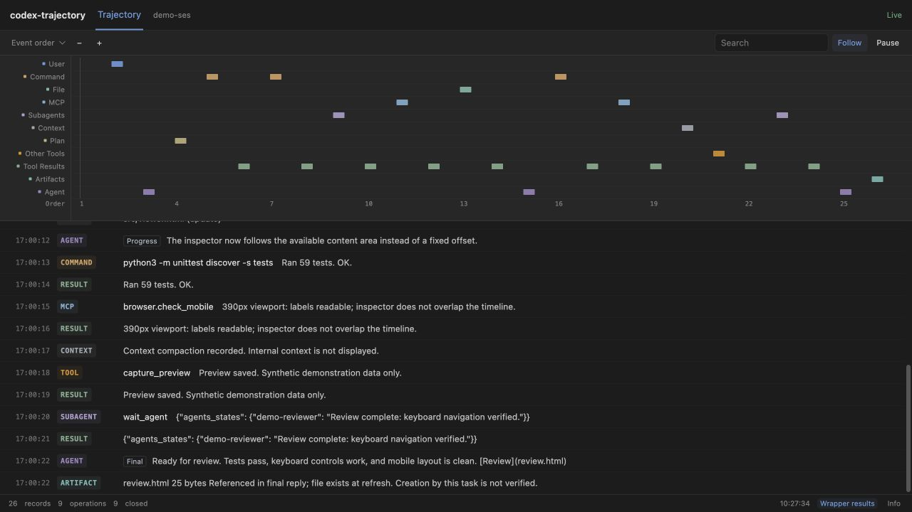

# trajectory

**Quiet, live, read-only timelines for local coding-agent sessions.**

[](https://github.com/Fly-Carrot/codex-trajectory/actions/workflows/tests.yml)


[](LICENSE)

Each observer reads the transcripts its agent already writes and shows public messages,
commands, file operations, MCP calls, subagents and tool results on the same
twelve-row timeline. One shared local process per agent. No additional model calls.
No API key.

| Folder | For | Installs as | Status |
| --- | --- | --- | --- |
| [`codex/`](codex/README.md) | Codex desktop and CLI | `codex-trajectory` | v0.3.0 preview |
| [`claude/`](claude/README.md) | Claude Code (desktop and CLI) | `claude-trajectory` | 0.1.x preview |

**Codex**

[](codex/README.md)

**Claude Code**

[](claude/README.md)

*Both screenshots use fictional demonstration data, not real conversations.
Click a preview for that observer's setup and usage instructions.*

The two implementations are independent: separate installers, hooks, runtime
directories, URL schemes and recovery apps. Installing one never changes the other.
Run each folder's commands from inside that folder, for example:

```bash
git clone https://github.com/Fly-Carrot/codex-trajectory.git trajectory
cd trajectory/claude
python3 install.py --dry-run
```

Shared fixes are applied to each folder separately and tested with that folder's own
suite. Tags are prefixed by component (`codex-v…`, `claude-v…`); earlier `v0.x` tags
belong to the Codex observer.

MIT licensed. See [SECURITY.md](SECURITY.md).
