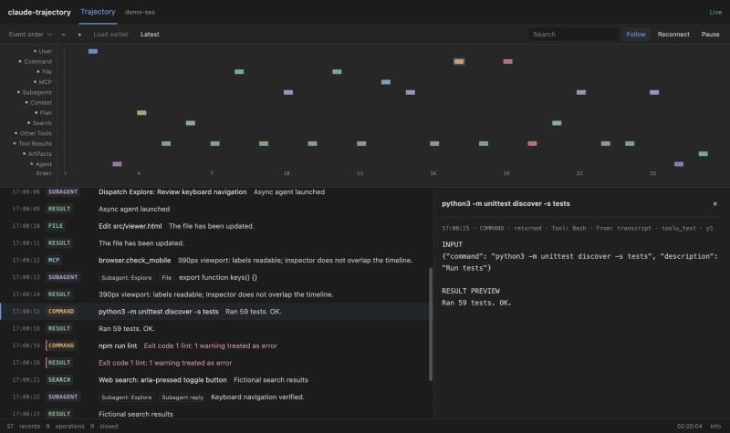

# claude-trajectory

**A quiet, live timeline for your Claude Code sessions.**

A read-only observer adapted from [codex-trajectory](https://github.com/Fly-Carrot/codex-trajectory).
It reads the transcripts Claude Code already writes and shows public messages,
commands, file operations, MCP calls, subagents and tool results as they arrive.
One shared local process. No additional model calls. No API key. Not a harness:
it never schedules agents, reviews work or changes how Claude Code runs.



*The screenshot uses entirely fictional demonstration data (`python3 demo.py`).*

## What you get

- Twelve compact rows in a fixed order: User, Command, File, MCP, Subagents, Context,
  Plan, Search, Other Tools, Tool Results, Artifacts, Agent. Empty rows stay.
- Shared horizontal scrolling, event-order / clock-time views, zoom and live Follow.
  Opening an event's details does not turn Follow off.
- One private URL per session, bound to the exact `session_id` and transcript path
  Claude Code reports. Never "the latest log", a window title or a project name.
- Subagents are linked through recorded IDs (`toolUseResult.agentId`, the subagent
  `.meta.json` `toolUseId`, and `agentId` on every subagent record), never by timing.
- No browser popups, no per-tool logging, no task gates.

See [docs/event-source-map.md](docs/event-source-map.md) for exactly which records
feed each row and which parts of the format are documented versus only observed.

## Requirements

Python 3.10+ (tested on 3.12 and 3.14), macOS or Linux, Claude Code that writes
JSONL transcripts under `~/.claude/projects` (verified with **2.1.185**). Standard
library only. Node is used only by the UI logic tests.

## Quick start: manual, no global changes

```sh
python3 trajectory.py register --session-id SESSION_ID
python3 trajectory.py register --transcript ~/.claude/projects/<project>/<session-id>.jsonl
```

Both forms print a verified private link. `--session-id` looks up the file named
exactly `<session-id>.jsonl` and refuses if it is not found exactly once. Inside a
Claude Code Bash tool, `url` and `resume` default to that session's
`CLAUDE_CODE_SESSION_ID`.

```sh
python3 trajectory.py url --session-id SESSION_ID      # verify an existing link; never starts anything
python3 trajectory.py resume --session-id SESSION_ID   # start the service if needed; fresh link
python3 trajectory.py stop                             # stop only the verified observer
```

Manual mode keeps its state in `.claude-trajectory-local/` inside this checkout.
`--auto-open` (register only) opens the link once on macOS; it is never the default.

## Optional automatic registration

```sh
python3 install.py --dry-run
python3 install.py
```

This copies the runtime to `~/.claude/claude-trajectory/` (private, `0700`) and adds
**two** command hooks to `~/.claude/settings.json`:

| Hook | Why it is needed (verified on 2.1.185) |
| --- | --- |
| `SessionStart` | Registers new and resumed sessions. The transcript may not exist yet, so the path is registered as pending. |
| `UserPromptSubmit` | Catches forks (`--fork-session` reports the parent ID at SessionStart; the new ID first appears here) and supplies the link to Claude once per context. |

It also adds a `/trajectory` command (`~/.claude/commands/trajectory.md`) that asks
Claude to run the `url` command and reply with the link, and a short rule block
between `<!-- CLAUDE-TRAJECTORY:BEGIN -->` and `<!-- CLAUDE-TRAJECTORY:END -->` at the
end of `~/.claude/CLAUDE.md`. The rule asks Claude to end each final reply with the
link supplied for this exact session, and gives the `url --session-id
"$CLAUDE_CODE_SESSION_ID"` command for re-verifying it. Use `--no-command` or
`--no-rule` to skip either. Nothing else changes: other hooks, permissions, MCP
servers, plugins and your own CLAUDE.md text are preserved, and the original
`settings.json` and `CLAUDE.md` are backed up privately first.
Re-running is idempotent. Use `--claude-home` (or `CLAUDE_CONFIG_DIR`) for a
non-default Claude home.

After a new prompt, the hook adds a short context note with the link and asks
Claude to end its final reply with `[Trajectory](http://127.0.0.1:PORT/s/SESSION#TOKEN)`.
This is **guidance the model may or may not follow, not a guaranteed UI injection**.
The link is supplied again only after a `SessionStart` (startup, resume, clear,
compact) or when the link changes. Old replies are never edited.

Hook behavior is bounded: each invocation registers one session and exits. It never
returns `block` or `deny`, never changes permissions, makes no network requests
beyond the local service, and records failures only as one line in
`runtime/hook-errors.log` (capped at 32 KiB, no payload content). Measured cost:
about 85 ms with the service running, about 220 ms when it must start the service.

Do not also install a plugin version of these hooks; that would register them twice.
Updating: `git pull`, `python3 install.py`, then `claude-trajectory stop` and `resume`
so the running service picks up the new files.

### Uninstall

```sh
python3 install.py --uninstall
```

Removes only the two owned hooks, the owned `/trajectory` file and the marked
CLAUDE.md block (text you added around it is kept). Settings keys this
tool created and left empty are removed again. Runtime, backups and the rebuildable
index stay in `~/.claude/claude-trajectory/` until you delete them. Uninstalling does
not stop a running service: `python3 ~/.claude/claude-trajectory/claude-trajectory stop`.

## Recovery

Each page has a **Reconnect** button. Transient failures retry with backoff up to
30 seconds without clearing history, Follow or selection. Hidden and paused pages
do not read logs. The status line distinguishes:

| Status | Meaning | What to do |
| --- | --- | --- |
| Reconnect required | The access token is no longer valid (service restarted) | `resume`, or local recovery |
| Service offline | Nothing answers on that port | `resume` |
| Transcript unavailable | The service answered, but this session's log cannot be read | Check the warning; no other session is substituted |
| Waiting for transcript | Registered before Claude Code wrote the file | Nothing; it fills in |
| Transcript missing - index only | The log was deleted after indexing | Summaries remain; details are unavailable |
| Deleted in Claude Code - index only | The desktop app deleted the session and left its release marker | Summaries indexed before deletion remain; details are unavailable. Sessions never opened before deletion have no history |
| Indexing history… | Older history is still being indexed | Wait; Load earlier unlocks when done |

```sh
python3 ~/.claude/claude-trajectory/claude-trajectory resume --session-id SESSION_ID
```

The service prefers its saved port. If another program holds it, a free port is
chosen and the occupant is left alone; open the newly printed link. Every real
restart rotates session tokens, so old links stop working even on the same port.
A stopped service cannot serve its own recovery button: use the command above.

Optional macOS recovery app (own `claude-trajectory://` scheme and bundle ID
`local.claude-trajectory.recovery`; it does not touch the Codex handler):

```sh
python3 install.py --recovery-only --dry-run
python3 install.py --recovery-only
```

The handler accepts only `claude-trajectory://reconnect/SESSION_ID`, asks for native
confirmation, runs the verified `resume`, and opens the link in your default browser
(it may open a new tab). Some embedded browsers block custom protocols; open
`~/.claude/claude-trajectory/Claude Trajectory Recovery.app` from Finder instead.
**Not yet verified in a real browser on this machine.**

## Event semantics

| Row | Meaning |
| --- | --- |
| User | A recorded user prompt (human origin, not injected `isMeta` content) |
| Command | `Bash` and other shell tools, with recorded success/failure |
| File | `Read` / `Write` / `Edit` / `NotebookEdit`, action shown separately |
| MCP | `mcp__<server>__<tool>` calls |
| Subagents | `Agent` dispatch, linked subagent transcript activity, hand-back reports |
| Context | A recorded compaction boundary; internal context is not shown |
| Plan | `EnterPlanMode`, `ExitPlanMode` (proposal), task-list tools. Entering, proposing and the recorded result are separate events; nothing is labelled approved. |
| Search | Native `WebSearch`, `Grep`, `Glob` only. `WebFetch`, browser MCP and `curl` keep their own rows. |
| Other Tools | Every other tool call |
| Tool Results | The recorded result of a call, at its return time, plus background-task completion notices. A result is not proof that a side effect succeeded. |
| Artifacts | Files linked in a final reply that exist inside the recorded workspace. Existence only; creation by this task is not verified. |
| Agent | Public assistant text. Final / Progress come from the recorded `stop_reason`. |

`Skill` calls are badged *invoked*; reading a `SKILL.md` is badged *file read*. Neither
means the skill completed. Plugin badges need explicit namespacing (`plugin:skill`,
`mcp__plugin_*`). Durations appear only when Claude Code recorded one
(`durationMs`, `totalDurationMs`, `durationSeconds`); timestamp gaps are not
presented as tool or model time. A call without a result yet stays *running*; it is
not marked failed. Thinking blocks, raw model requests (`api-request*`), system
attachments and compaction summaries are never parsed or indexed.

## How it works

```text
Claude Code
  ├─ SessionStart / UserPromptSubmit hook → exact session_id + transcript_path
  └─ transcript JSONL (read-only, incremental)
        → Claude event adapter → one shared loopback service
        → private rebuildable per-session SQLite index → this timeline UI
```

The page polls every 1.5 s while visible; hidden pages make a lightweight check every
30 s without reading logs. At most eight session readers stay cached; idle readers
expire after two minutes. Each refresh indexes a bounded 2 MiB forward chunk per
source plus one 2 MiB backward chunk. Pages hold the latest 20 turns / 300 events;
the browser keeps at most 1,200 events. Partially written lines are re-read when the
file grows, never parsed early. Indexes share a 512 MiB budget; least-recently-used
inactive indexes are removed and rebuilt on demand. If a transcript changes under an
existing index, the index is rebuilt; the transcript itself is never modified.

Measured on an Apple M4 Max, macOS 26.6.2, Python 3.14.6 (details and method in
[docs/verification.md](docs/verification.md)): a 102 MB synthetic transcript showed its
first page in 86 ms and finished indexing with 2.1 s of total CPU; unchanged refreshes
took 4 ms; the service used 39 MiB RSS; the index was 30 MB.

## Privacy and security

- Loopback only (`127.0.0.1`). Per-session random bearer tokens, private state files.
- Strict Host and Origin checks, no CORS, `no-store`, restrictive CSP, no redirects.
- The CLI proves the service's identity with a nonce/HMAC before sending credentials,
  and never forwards credentials through proxies.
- Transcript paths must be exactly `<projects>/<project>/<session>.jsonl` (or the
  linked `subagents/agent-<id>.jsonl`); every component is opened without following
  symlinks, records from other sessions are ignored, and the first identity-bearing
  record must match the registered session.
- Device and inode numbers are only hints; after a storage change, saved record hashes
  must match before cached history is reused.
- Log content is untrusted: it is rendered with `textContent` only, links in it are
  never fetched, and nothing in it is executed.
- Common credentials and home-directory usernames are masked best-effort. **This is not
  a guarantee that arbitrary text is safe to share.** Tool output can contain secrets.
- Never publish a real screenshot, token URL, transcript, runtime state or backup
  without reviewing it.

This is local HTTP, not an authenticated HTTPS origin or a sandbox against local
malware. A process running as your user can read the same logs and state.

## Development

```sh
python3 -B -m unittest discover -s tests -v
TRAJECTORY_NODE=/path/to/node python3 -B -m unittest discover -s tests   # include UI logic tests
python3 demo.py
```

All test fixtures are synthetic and labelled as such. They are not a substitute for
checking against a real Claude Code session; see [docs/verification.md](docs/verification.md)
for what was verified on a real host and what remains unverified.

## Status and credits

**v0.1.0, experimental.** Claude Code does not publish a transcript schema; the
adapter follows what version 2.1.185 writes and may need updates for later versions.

Adapted from [codex-trajectory](https://github.com/Fly-Carrot/codex-trajectory)
(MIT, Copyright (c) 2026 Fly-Carrot): the timeline UI, loopback service, bounded index,
redaction and recovery design are reused; session identity, transcript parsing and
installation are new. Independent project; no affiliation with Anthropic or OpenAI.

See [CHANGELOG.md](CHANGELOG.md) and [SECURITY.md](SECURITY.md).
